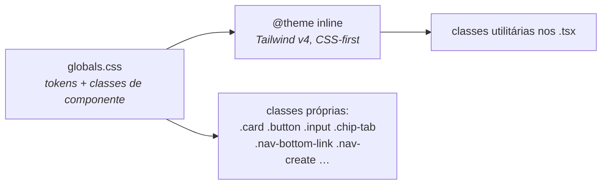

# Kina — Auditoria do repositório (Fase 0)

> Gerada em 2026-10-14, a partir do código real. **Nenhum arquivo de código foi alterado** nesta fase.
> Estado do working tree na hora da auditoria: `apps/web/src/features/users/mapPoint.ts` já estava modificado (alteração anterior, fora desta tarefa) e `docs/kina/*` com mudanças pendentes. A auditoria lê esses arquivos como estão.
> Status da seção *Divergências*: **aguardando revisão de uma pessoa** (critério de conclusão da Fase 0).

---

## 1. Stack

| Item | Valor | Onde confirmei |
| --- | --- | --- |
| Estrutura | Monorepo pnpm + Turborepo (`resenhometro`) | `package.json`, `pnpm-workspace.yaml`, `turbo.json` |
| Gerenciador | pnpm 10.11 · Node ≥ 22 | `package.json` (`packageManager`, `engines`) |
| Web | **Next.js 15 (App Router) + React 19**, TypeScript | `apps/web/package.json`, `apps/web/src/app/` |
| Roteador | App Router do Next (`apps/web/src/app/**/page.tsx`) | — |
| Bundler | Turbopack em dev (`next dev --turbopack`), `next build` em produção | `apps/web/package.json` |
| API | Fastify 5 + Zod, Postgres (`postgres`) / PGlite local, JWT em cookie | `apps/api/package.json`, `apps/api/src/` |
| Deploy | Vercel (web e api têm `vercel.json`) + Supabase | `DEPLOY.md` |
| HTTP no front | Axios (`apps/web/src/lib/api.ts`) | — |
| Animação | `motion` 13 (só no `ThemeToggle`; `WaveBackground` é próprio) | `Theme.tsx`, `WaveBackground.tsx` |
| Ícones | **`lucide-react`** (já existe: `@phosphor-icons/*` **não** deve entrar) | `apps/web/package.json` |
| Mapa | `maplibre-gl` 6 | ver § 5 |
| Outros apps | `apps/mobile` e `apps/desktop` são **placeholders** (`echo "em breve"`) | `package.json` de cada um |
| Pacotes | `@resenhometro/shared` (tipos e constantes), `@resenhometro/config` (tsconfigs), `@resenhometro/ui` | `packages/` |

> **`@resenhometro/ui` não é usado.** Só tem um `Button` que repassa props; nenhum arquivo de `apps/web/src` importa dele. Os componentes reais moram em `apps/web/src/components/`.

---

## 2. Estilos e temas

### 2.1 Estilos

- **Tailwind v4** via `@tailwindcss/postcss` (`postcss.config.mjs`). **Não há `tailwind.config.*`**: o tema vive em `@theme inline` dentro de `apps/web/src/app/globals.css`.
- **Sem biblioteca de UI** (nada de shadcn, MUI, Chakra). Os "componentes" são classes CSS em `@layer components` + 8 componentes React pequenos.
- Os tokens atuais têm nomes próprios (`--background`, `--surface`, `--primary`, `--accent-cool`, `--radius-*`, `--shadow-*`…) e vários aliases legados (`--bg`, `--card`, `--line`, `--accent`, `--brand-red`…). **Não existe nenhum `--k-*`.**
- Fontes: Plus Jakarta Sans + Inter (via `next/font/google`) e **Bomb Font** (`public/fonts/BombFont.otf`, local). Não há Fraunces, Schibsted Grotesk nem IBM Plex Mono.
- Efeitos que o plano manda remover e **existem hoje**: sombras em cartões e botões (`--shadow-*`), `backdrop-filter` (4 arquivos), gradientes (4 arquivos), pílulas (`.chip-tab`, `.composer-chip`, `rounded-full` em 15 arquivos), fundo de ondas animadas (`WaveBackground`), grão por SVG inline (`.grain-overlay`, classe definida mas **não usada** em nenhum `.tsx`).
- `dark:` do Tailwind: **0 ocorrências** (bom — o tema é por variável).

### 2.2 Temas claro/escuro

| Aspecto | Como é hoje |
| --- | --- |
| Mecanismo | `data-theme="light\|dark"` no `<html>` + `color-scheme` |
| Padrão do `<html>` | `data-theme="dark"` **fixo no JSX** de `layout.tsx` |
| Persistência | `localStorage['resenhometro_theme']` |
| Anti-flash | script inline `themeScript` em `layout.tsx` (lê o `localStorage`, senão `prefers-color-scheme: light`) |
| Alternância | `ThemeToggle` (ícone sol/lua) com View Transition circular (`Theme.tsx`) |
| Seletor "Sistema / Claro / Escuro" | **não existe**; só alterna claro ↔ escuro |

Pontos que conflitam com o plano (detalhados em § 7): o `ThemeProvider` **grava no `localStorage` já na montagem** (`applyTheme` no `useEffect`), então a preferência do sistema vira "escolha salva" na primeira visita; e o atributo padrão é `dark`, não "ausente".

---

## 3. Rotas / telas

Todas em `apps/web/src/app/<rota>/page.tsx`, com a tela real em `apps/web/src/features/<dominio>/`. Exceto `login`, `cadastro`, `esqueci-senha` e `redefinir-senha`, as páginas se embrulham em `RequireAuth` → `AppShell`.

| Rota | Arquivo da tela | Acesso |
| --- | --- | --- |
| `/` (feed) | `features/social/FeedScreen.tsx` | **logado** |
| `/login` | `features/auth/LoginScreen.tsx` | público |
| `/cadastro` | `features/auth/CadastroScreen.tsx` | público |
| `/esqueci-senha` | `features/auth/EsqueciSenhaScreen.tsx` | público |
| `/redefinir-senha` | `features/auth/RedefinirSenhaScreen.tsx` | público |
| `/explore` | `features/search/ExploreScreen.tsx` | logado |
| `/roles` | `features/roles/RolesListScreen.tsx` | logado |
| `/roles/new` | `features/roles/NewRoleScreen.tsx` | logado |
| `/roles/[id]` | `features/roles/RoleDetailScreen.tsx` | logado |
| `/roles/[id]/editar` | `features/roles/EditRoleScreen.tsx` | logado |
| `/reviews/[id]` | `features/reviews/ReviewDetailScreen.tsx` | logado |
| `/perfil` | `features/users/ProfileRedirectScreen.tsx` | logado |
| `/perfil/[username]` | `features/users/ProfileScreen.tsx` | logado |
| `/amigos` | `features/social/FriendsScreen.tsx` | logado |
| `/chat`, `/chat/[username]` | `features/chat/ChatListScreen.tsx`, `ConversationScreen.tsx` | logado |
| `/notifications` | `features/notifications/NotificationsScreen.tsx` | logado |
| `/music` | `features/music/MusicScreen.tsx` | logado |
| `/mapa` | `features/users/PeopleMapScreen.tsx` | logado |
| `/calendar` | `features/stats/CalendarScreen.tsx` | logado |
| `/stats` | `features/stats/StatsScreen.tsx` | logado |
| `/year-review` | `features/stats/YearReviewScreen.tsx` | logado |
| `/photos` | `features/media/PhotosScreen.tsx` | logado |
| `/settings` | `features/settings/SettingsScreen.tsx` | logado |

Também existe `app/loading.tsx` (loader de marca). **Não existe** `not-found.tsx`, `error.tsx`, `manifest.*` nem `robots.*`.

### Navegação atual (`components/AppShell.tsx`)

- **Desktop (≥ lg):** cabeçalho superior fixo com wordmark, abas *Feed / Explorar / Rolês*, botão "Criar", busca, tema, sino e menu da conta (Mensagens, Calendário, Música, Estatísticas, Amigos, Mapa, Fotos, Configurações). Coluna lateral direita (≥ xl) com "Próximos rolês", "Sugestões" e prévia do chat.
- **Celular (< lg):** barra inferior com 5 itens — Feed, Explorar, **Criar** (botão redondo central), Rolês, Perfil.
- Não existe `NavRail` lateral. **Não há item "Mapa" nem "Música" na barra inferior** (estão no menu da conta); o plano (3.1) os coloca na `TabBar`.

---

## 4. Componentes reutilizáveis

Contagem = nº de arquivos em `apps/web/src` que importam o componente.

| Componente | Caminho | Telas/arquivos que usam | Observação |
| --- | --- | --- | --- |
| `Button` | `components/Button.tsx` | 24 | variantes via classes `.button--*` |
| `RequireAuth` | `components/RequireAuth.tsx` | 19 | guarda + `AppShell` |
| `Avatar` | `components/Avatar.tsx` | 17 | prop `glow` |
| `Field` / `Input` | `components/Field.tsx` | 16 | rótulo visível |
| `Card` | `components/Card.tsx` | 15 | + `className="card"` direto em **30** arquivos |
| `Toast` | `components/Toast.tsx` | 14 | `ToastProvider` no layout |
| `MediaImage` | `components/MediaImage.tsx` | 9 | com fallback |
| `BrandMark` (`BrandSymbol`, `BrandLoader`) | `components/BrandMark.tsx` | 6 | |
| `Theme` (`ThemeProvider`, `ThemeToggle`) | `components/Theme.tsx` | 6 | |
| `BrandWordmark` | `components/BrandWordmark.tsx` | 5 | |
| `Player` (`PlayerProvider`, `usePlayer`) | `components/Player.tsx` | 5 | iframe do Spotify no layout raiz |
| `ErrorBoundary` | `components/ErrorBoundary.tsx` | 2 | |
| `AppShell` | `components/AppShell.tsx` | 1 | |
| `WaveBackground` | `components/WaveBackground.tsx` | 1 | removível na Fase 1 |

**Padrões que existem só como classe CSS** (sem componente): `.chip-tab` (abas, 4 arquivos), `.icon-btn` (5), `.reaction-btn` (1), `.composer-chip` (1), `.skeleton` (4), `.nav-bottom-link`, `.nav-create`, `.profile-stat`, `.chat-badge`.

**Não existem** (a criar na Fase 2): `Tag`, `Tabs` (hoje é `.chip-tab`), `Modal`/`Sheet` (há modais soltos, ex.: `StoriesBar`, `StoryViewer`), `Menu` (o menu da conta é um `div` dentro do `AppShell`), `EmptyState`, `Spinner`, `Skeleton` como componente, `AvatarStack`, `TrackRow` (há `MusicCard`), `FichaRow`, `Corners`, `NavRail`, `TabBar`, `KinaLogo`.

---

## 5. Onde estão cores, fontes e ícones hoje

### Cores

- Fonte quase única: `apps/web/src/app/globals.css` (centenas de valores, inclusive `#12121a`, `#f3eee4`, `#ef4561` etc., dentro de `:root` e `html[data-theme]`). Isso **é** o tema atual e vira `tokens.css`.
- Hexadecimais **fora** do `globals.css` (`grep -rE "#[0-9a-fA-F]{3,8}\b" apps/web/src`):

| Arquivo | Valor | O que é |
| --- | --- | --- |
| `app/layout.tsx:29-30` | `#f3eee4`, `#0b0b0f` | `themeColor` do viewport |
| `components/Player.tsx:191` | `#1DB954` | verde do Spotify no botão |
| `features/music/MusicCard.tsx:101` | `#1DB954` | idem |
| `features/music/MusicScreen.tsx:401,411` | `#1DB954` | idem (anel e botão) |
| `features/users/mapPoint.ts` (8 ocorrências: 195, 219, 228, 245, 387, 388, 425, 442) | `#1c1917`, `#fff`, `#2563eb`, `#ffffff` | marcadores, halo e **rota (azul `#2563eb`)** do mapa, em `style.cssText` / paint do MapLibre |
| `api/src/lib/mail.ts` (fora do web) | `#0b0b0f`, `#f3f1ec`, `#e31d3c`, `#a8a8b4` | e-mail de redefinição de senha |

- Além disso, **36 usos** de `bg-white|black`, `text-white|black`, `border-white`, `from-/via-/to-` no Tailwind (ex.: `YearReviewScreen` usa `text-white/70`).
- `rgba()/rgb()/hsl()` inline fora do CSS: 6 ocorrências.

### Fontes

`Plus Jakarta Sans` e `Inter` (`next/font/google`, `layout.tsx`) + `Bomb Font` (local, `@font-face` no CSS, classe `.font-display`). `public/fonts/` tem só `BombFont.otf`. Escala tipográfica própria (`--text-display`… `--text-label`, 12 px é o menor).

### Ícones e marca gráfica

`lucide-react` em todo o app. Marca: `public/brand/` (`wordmark(.svg|-dark.svg)`, `symbol-3d.png`, `mascote.*`, favicons, `apple-touch-icon.*`), `public/icon.svg`, `src/app/icon.svg`, `src/app/apple-icon.png`, `public/favicon.ico`.

---

## 6. Ocorrências do nome antigo

O nome do produto tem **duas grafias** no repositório: "Redesinha" (UI) e "Resenhômetro/resenhometro" (pacotes, cookies, API, docs). O plano só cita "Redesinha".

### 6.1 "Redesinha" (`grep -rni "redesinha"`, excluindo `docs/kina`)

| Arquivo | Linha | Contexto |
| --- | --- | --- |
| `apps/web/src/app/layout.tsx` | 35, 37 | `metadata.title` e `applicationName` |
| `apps/web/src/components/BrandWordmark.tsx` | 4, 17 | `ALT` e texto visível do wordmark |
| `apps/web/src/components/RequireAuth.tsx` | 42 | "Entrando no Redesinha" |
| `apps/web/src/features/stats/YearReviewScreen.tsx` | 25, 26 | "REDESINHA WRAPPED" e "Seu {ano} no Redesinha" |
| `apps/web/public/brand/wordmark.svg`, `wordmark-dark.svg` | 1 | `aria-label` (e o texto desenhado no SVG) |
| `apps/web/public/icon.svg`, `apps/web/src/app/icon.svg` | 1 | `aria-label` |
| `docs/front/app-mobile.MD` | 7, 28 | documentação de produto |
| `CLAUDE.md` (raiz) | 7 | menção intencional ao nome antigo |

Não há `manifest.json` (nada a trocar lá) e nenhum "Redesinha" em e-mail. `apps/api/src/lib/mail.ts` comenta "identidade **Redesenha**" (outra grafia).

### 6.2 "Resenhômetro / resenhometro" (fora do escopo literal do plano; precisa de decisão)

- **Visível ao usuário** (trocar na Fase 1): `MusicScreen.tsx:305` ("sem sair do Resenhômetro"), e-mail de senha (`mail.ts`: assunto, selo `RESENHÔMETRO`, remetente padrão), `auth.service.ts:103` (assunto).
- **Identificadores técnicos — NÃO renomear sem decisão:** cookie de sessão `resenhometro_session` (`apps/api/src/lib/session.ts`; renomear **desloga todo mundo**), chaves de `localStorage` (`resenhometro_theme`, `resenhometro_token`, `resenhometro_user`, `resenhometro_spotify_connected`), bucket `resenhometro-uploads`, escopo `@resenhometro/*` dos pacotes, `APP_NAME = 'Resenhômetro'` em `packages/shared/src/constants.ts`, nome do banco local nos READMEs.
- Docs/READMEs/templates: `apps/*/README.md`, `DEPLOY.md`, `.github/ISSUE_TEMPLATE/bug_report.md`, `.cursor/skills/sdd-*/SKILL.md`.

---

## 7. Funcionalidades confirmadas

### Login

- **E-mail + senha.** `POST /auth/login` (`apps/api/src/modules/auth/auth.routes.ts`); `LoginScreen` envia `{ email, password }`, `minLength={6}`.
- Sem link mágico e **sem OAuth de login**. Há cadastro (`/auth/register`), recuperação (`/auth/forgot-password` + e-mail SMTP) e redefinição.
- Sessão: JWT em **cookie httpOnly** (`resenhometro_session`, 7 dias) **e** o mesmo token também volta no corpo da resposta e é guardado em `localStorage` (`resenhometro_token`) como reserva. Limite de tentativas por IP.
- Há links "Esqueci a senha" e "Criar conta" na mesma tela — o painel da 3.2 precisa abrigá-los.

### Mapa

- **`maplibre-gl` 6**, estilo **raster** apontando para `https://tile.openstreetmap.org/{z}/{x}/{y}.png` (`MAP_STYLE` em `features/users/mapPoint.ts`).
- A **biblioteca aceita estilo customizado** (o `MAP_STYLE` é um objeto controlado pelo código), mas a **fonte** é raster pronto: não dá para aplicar a paleta Kina em ruas/água/parques. Recolorir (plano 4.4, 1º ramo) exige trocar para tiles vetoriais, o que é decisão de provedor/custo. As tiles do `tile.openstreetmap.org` **não são para produção em escala** (política de uso do OSM) e **não aceitam recolorir**; recolorir de verdade exige vetorial (ex.: OpenFreeMap/MapTiler/Protomaps) ⇒ **decisão externa ao design** (custo, chave, dependência).
- Usos: `LocationMap` (ponto do rolê/local), `PeopleMapScreen` (`/mapa`, pessoas), `RoutePanel` (rota via `lib/routing.ts`), `PlaceField`/`PlaceSearch` (busca de lugar via `lib/geocode.ts`), `SettingsScreen` (localização do perfil).
- Marcadores: foto 40 px circular (pessoa) e pino padrão do MapLibre; "você" e rota em azul `#2563eb`.

### Spotify

- **OAuth de conexão de conta** (não é login). Fluxo: `GET /spotify/connect` → Spotify → `GET /spotify/callback` (`music.routes.ts`, `music.service.ts`). `state` assinado com HMAC (TTL 10 min, tabela `spotify_oauth_states`).
- **Escopos:** `user-read-private user-read-email user-read-currently-playing user-read-playback-state playlist-read-private playlist-read-collaborative user-library-read`, com `show_dialog=true`.
- Tokens em `spotify_connections` (`access_token`, `refresh_token`, `expires_at`); **renovação por `refresh_token`** no servidor.
- Erros de token expirado/escopo: `explainSpotifyRefusal` devolve mensagens em pt-BR ("Faltam permissões…", "A sessão do Spotify venceu. Desconecte e conecte de novo…"). **Não há estado "expirado" na UI**; é mensagem de erro, com ação "Reconectar Spotify".
- Onde aparecem capas/faixas: `MusicScreen`, `MusicCard`, `SpotifyPicker`, `ExpandableList`, `Player` (barra flutuante), música anexada em rolê, story e post, `StatsScreen` (top faixas/artistas).
- **Reprodução = iframe oficial** `open.spotify.com/embed/...` (`lib/spotifyEmbed.ts`, `lib/spotifyIframeApi.ts`). Isso já respeita as regras do Spotify; o plano diz "não imitar o player" — o `Player` flutuante não imita, **embute** o oficial.
- O verde `#1DB954` está hardcoded em 4 pontos (§ 5) como botões "tocar" — é cor do Spotify, **precisa de exceção explícita** ao "nenhum hexadecimal".
- Atribuição/link ao Spotify e logo oficial: **não confirmado**; conferir nas Spotify Design Guidelines antes da Fase 4.3.

### Modelo de dados (`packages/shared/src/types.ts`, `apps/api/src/db/migrate.ts`)

| Conceito | Existe? | Detalhe |
| --- | --- | --- |
| **Rolê** | sim | `title`, `description`, `date`, `time`, `location`, `latitude/longitude` (par), `category` (12 fixas), `estimatedCost`, `tags[]`, `status` (`upcoming/ongoing/past/cancelled`), `banner`, `coverPhoto`, contagens de presença/comentário, `averageRating`, `creator` |
| Presença | sim | `going` / `maybe` / `not_going` (rota `POST/PUT /roles/:id/attendance`) |
| Publicação (`SocialPost`) | sim | só `content` + música opcional. **Sem imagem própria e sem vínculo com rolê** (tabela `posts`: `id, author_id, content, created_at` + colunas de música) |
| Evento de feed | sim | 8 tipos: `role_created`, `review_published`, `attendance_going`, `photo_added`, `audio_added`, `music_added`, `achievement_unlocked`, `post_created` — **o feed mistura tipos**, não é só "publicação" |
| Story | sim | foto/vídeo ≤ 15 s, **expira em 24 h**, legenda, música opcional, visualizações, resposta (`/stories/:id/reply`), até 20 ativos |
| Perfil | parcial | `avatar`, **`cover`**, `bio`, `city`, `isPublic`, local no mapa; `stats` (rolês, resenhas, amigos, seguidores, seguindo), conquistas. **Sem "música do perfil"** |
| Curtida | **diferente** | não há "curtir"; há **reações com 5 emojis** (`heart, laugh, cry, fire, eyes`) em rolê, resenha, post, comentário, foto e áudio |
| Comentário | sim | com respostas aninhadas e reações |
| Seguir | sim | `POST/DELETE /users/:id/follow` + botão "Seguir/Seguindo" (`follows`) |
| Amizade | sim | **separada** de seguir: `friendships` com `pending/accepted/rejected` (`/friends/*`) |
| Resenha (`Review`) | sim | notas por 6 categorias, texto, vinculada a rolê — **não está no plano de design** |
| Fotos / álbuns / áudios | sim | `/photos`, `albums`, `audios` — **não estão no plano** |
| Chat | sim | mensagens diretas com imagem (`/chat/*`) — **não está no plano** |
| Notificações | sim | 9 tipos |
| Estatísticas / Calendário / Retrospectiva | sim | `/stats`, `/calendar`, `/year-review` — **não estão no plano** |
| Conquistas | sim | 10 definidas |

### Rascunho de rolê e landing pública

- **Rascunho de rolê: não existe.** `RoleStatus` não tem `draft`. As únicas ocorrências de "draft" no código são *estado local de formulário* (`SettingsScreen`, `StoriesBar` — prévia antes de publicar o story).
- **Landing pública separada: não existe.** `/` exige login (`RequireAuth`) e redireciona a `/login`. Públicas: `/login`, `/cadastro`, `/esqueci-senha`, `/redefinir-senha`.

### Testes e como rodar

| Onde | Arquivos | Como rodar |
| --- | --- | --- |
| API (`apps/api`) | 12 `*.test.ts` (auth, chat, music/spotify, roles, banner, feed, storage, rate-limit, env, helpers) | `pnpm test` (raiz) → `vitest run` em `@resenhometro/api`; `fileParallelism: false` (PGlite compartilhado) |
| Web (`apps/web`) | 5 `*.test.ts` (`expandable`, `mapPoint`, `geocode`, `shellCache`, `spotifyEmbed`) — **só lógica, sem componente** | ⚠ **Nenhum script `test` nem `vitest` no `package.json` do web**; o `pnpm test` da raiz filtra só a API. Esses 5 arquivos **não rodam em CI nem por `pnpm test`** |
| E2E / a11y | **nenhum** (sem Playwright, axe ou Testing Library) | — |
| CI | `.github/workflows/ci.yml`: `pnpm lint` + `pnpm typecheck` (**sem testes, sem build**) | — |

Para este redesign o "portão" real é `pnpm lint && pnpm typecheck` + `pnpm --filter @resenhometro/web build` (o build não está no CI) + conferência manual.

---

## 8. Divergências do plano de design

> O que o plano/PDF supõe e **não existe** (ou existe diferente) no código. Regra do plano (§ 0.4): **não inventar a funcionalidade**; implementar só a parte visual e registrar aqui. **Revisão humana pendente.**

### 8.1 Funcionalidade que não existe

| # | O plano supõe | Realidade | Efeito no plano |
| --- | --- | --- | --- |
| D1 | **Landing pública** "Te vejo na Kina." (3.3) | `/` exige login; não há rota pública de apresentação | **Pular 3.3** (decisão pendente já prevê). A frase "Te vejo na Kina." pode entrar no `/login`, sem criar rota |
| D2 | **Rascunho de rolê** | não existe (`RoleStatus` sem `draft`) | Fora de escopo (já previsto) |
| D3 | **Publicação ↔ rolê** (`Post` em camadas, "em *Nome do rolê*", fila de quem estava, faixa de fundo — 4.1) | `SocialPost` = texto + música; **sem `roleId`**; não há foto no post | `Post` entra no modo **"sem rolê vinculado"** (padrão do plano). A versão em camadas fica **sem faixa de fundo e sem "em …"**. Não criar o vínculo (seria mudança de contrato/banco) |
| D4 | **Foto na publicação**; "grade de publicações" no perfil (3.4) | o que tem imagem é `Photo` (aba **Fotos**); post é só texto | "Grade com `.k-corners`" aplica-se às **fotos** e aos rolês, não a posts |
| D5 | **Música do perfil** (3.4) | não existe campo | Omitir (o plano diz "se existir") |
| D6 | **Curtidas** | existem **5 reações com emoji**, não um "curtir" | `Post` usa o componente `Reactions` atual; só restyle. Nada de coração único |
| D7 | **"Seguir"** como ação principal do perfil | existe **Seguir** *e* **amizade** (pedido/aceite) — dois sistemas | Tratar os dois botões existentes; o plano fala em "a que existir hoje" (3.4). Ver `ProfileScreen.tsx:207` e `FriendsScreen` |
| D8 | **Convites** (3.7 "futuro: convites/rolês") | `NotificationType` tem `invite`, mas não há convite como entidade | "Futuro" do feed = rolês `upcoming` (já vêm no feed como `role_created` e no `/calendar`); sem seção de convites |
| D9 | **Agenda "Sua agenda"** no feed | existe: `/calendar` (`upcoming`) já alimenta "Próximos rolês" no `DefaultRail` | Reaproveitar a mesma fonte; sem endpoint novo |
| D10 | **Stories "em pontos de 58 px", anel de não visto** | `StoriesBar` + `StoryRing.hasUnseen` já existem | Só restyle |
| D11 | **Seletor de tema Sistema/Claro/Escuro** em Configurações (4.5) | só existe alternância claro ↔ escuro (`ThemeToggle`); "sistema" é só o valor inicial | Criar o seletor é **UI + lógica nova de preferência** (guardar `system`). Dentro do visual? É pequeno, mas **altera o formato do valor salvo** → decidir (ver ajustes) |
| D12 | **"Cola?"** como ação de presença | o botão hoje diz **"Bora"** / "Confirmado" (`RoleDetailScreen.tsx:119-120`); no feed a ação é `POST attendance {status:'going'}` | Só troca de texto. Existe ainda *talvez* e *não vou* — o plano só prevê o "Cola?" |
| D13 | **Ficha do rolê**: Quando, Onde, Quem, Trilha (3.5) | campos reais no formulário: Nome, Descrição, Data, Hora, **Local (com ponto no mapa)**, Categoria, **Custo estimado**, **Tags**, Banner, e música (via `POST /roles/:id/music` depois de criado) | "Só as linhas que existirem": entram também **Categoria, Custo e Tags**. **"Quem" não existe na criação** (o convite é por presença depois). "Trilha" só no detalhe/edição, não no formulário de criação |
| D14 | Rolê criar/editar com **banner/capa** | existe (`BannerField`, `POST /roles/:id/banner`) | OK; usar `BannerField` como "área de capa" |
| D15 | **Abas do perfil:** Publicações / Rolês / Músicas | abas reais: **Resumo, Rolês, Resenhas, Fotos, Áudios, Música, Estatísticas** (7) | Manter as 7; o plano permite "só as que existirem". Atenção a 7 abas no celular (rolagem horizontal) |
| D16 | **Tela de busca com grupos** pessoas/rolês/lugares | `SearchResults` já traz `people, roles, reviews, tags, places, music` | Restyle; há grupos a mais (resenhas, tags, música) |
| D17 | **404 "Essa rua não existe."** | **não há `not-found.tsx`** | Criar página 404 é só tela estática nova — ok dentro do visual, mas é arquivo novo de rota (`app/not-found.tsx`); confirmar |
| D18 | **PWA/`manifest.json`** (Fase 1: name, theme_color…) | **não existe manifest** | Não criar sem decisão (acrescenta PWA instalável). Atualizar só `themeColor` do viewport e metadados |
| D19 | **Funcionalidades fora do plano** | Chat, Resenhas, Fotos/Álbuns, Áudios, Estatísticas, Retrospectiva (`/year-review`), Conquistas, Amigos, Mapa de pessoas | O PDF não desenha essas telas. Aplicar tokens/componentes, mas **sem layout de referência** (ver Ajustes) |

### 8.2 Premissas técnicas que não batem

| # | O plano supõe | Realidade |
| --- | --- | --- |
| T1 | `tailwind-preset.js` (**Tailwind v3**) ou "v4 em `@theme`" | É **v4 sem `tailwind.config`**; o preset v3 **não se aplica**. Usar `@theme` apontando para `var(--k-*)` |
| T2 | `public/fonts/`, `public/textures/` | Existem (`public/fonts/BombFont.otf`); **não existe `public/textures/`**. Fontes atuais vêm do `next/font/google`, **não** de `/public` |
| T3 | Pré-carregar fontes com `<link rel="preload">` no `<head>` | Next gerencia fontes (`next/font`). Para as fontes do kit (woff2 locais) o idiomático é **`next/font/local`** ou `@font-face` + `preload` em `metadata`/`<head>` do `layout.tsx` |
| T4 | `import.meta.env.DEV` para a vitrine `/__kina` | Isso é **Vite**. No Next é `process.env.NODE_ENV !== 'production'`. Além disso, pasta `app/__kina` começando com `_` é **privada** no App Router e **não vira rota** → usar `app/kina-vitrine/` (ou `(dev)`) com `notFound()` em produção |
| T5 | "Sem escolha salva, não setar `data-theme`" e "Reaproveitar a persistência" | `layout.tsx` **fixa `data-theme="dark"`** e o `ThemeProvider` **salva no `localStorage` na montagem** (`Theme.tsx:37-38`). Para o CSS "seguir o sistema" é preciso mudar esse comportamento, **e o padrão atual é escuro**, não "sistema" |
| T6 | `--k-bg` + `.k-grain` no `body` | Fundo atual: `WaveBackground` (SVG animado) + `.grain-overlay` (não usado). Ambos saem; `body` está com `background: transparent` |
| T7 | `Skeleton` com fios e pontos; `Spinner` ponto-no-L | Hoje: `.skeleton` com **shimmer em gradiente** (contraria "sem gradientes") e `.button__spinner` circular; loader de marca com barra (`.brand-loader-*`) |
| T8 | "Sem sombra, sem gradiente, sem vidro" | `backdrop-blur` (4 arquivos), `shadow-*` (5), gradientes (4), `--card-blur`, `--chrome-blur`, `.glow-btn`, `box-shadow` em `.button/.input/.card` |
| T9 | Raio 0/2 px; "só pessoas redondas" | `--radius-sm…xl` = 10–24 px; **`border-radius: 9999px` em inputs do login**, botões, abas, chips, ícones, `.reaction-btn`, `.chat-badge`, 15 arquivos com `rounded-full` |
| T10 | Texto mínimo ≥ 14 px (implícito pela escala do kit) | Escala atual tem **12 px** (`--text-label`) e há `text-[10px]` (`.nav-bottom-link`, `.chat-badge`) e `text-xs` espalhado |
| T11 | `.k-street-grid`, `.k-corners`, etc. **vêm do `tokens.css`** | Confirmar na Fase 1 que `tokens.css` realmente define essas classes (não verifiquei o conteúdo dele aqui, só a existência do arquivo) |
| T12 | `@phosphor-icons/*` se não houver ícones | Já existe `lucide-react`. **Não adicionar Phosphor**; adaptar o inventário de ícones do kit para equivalentes do Lucide (ou justificar no PR) |
| T13 | `KinaLogo` com SVG do símbolo + wordmark em texto | Hoje o wordmark é **imagem** (`public/brand/wordmark*.svg` com o texto "Redesinha" *desenhado no SVG*) + `BrandSymbol` (PNG 3D `symbol-3d.png`). O SVG antigo precisa ser **substituído**, não só o texto do componente |
| T14 | `Button` com 4 variantes (primary, secondary, text, create) | Hoje: `primary, secondary, outline, danger, ghost`, mais `loading`. **`danger` não existe no plano** (ver Ajustes) |
| T15 | O `CLAUDE.md` da raiz já foi mesclado | Existe, mas com **codificação quebrada** (caracteres como `—`, `é`). O texto do kit foi salvo com a codificação errada; corrigir antes de depender dele |

---

## 9. Riscos

| # | Risco | Gravidade | Mitigação |
| --- | --- | --- | --- |
| R1 | **Renomear cookie/chaves `resenhometro_*`** desloga usuários e zera tema/Spotify local | Alta | Não renomear nesta rodada. Só texto visível. Se quiserem, migração à parte (ler as duas chaves) |
| R2 | **Estilos globais por seletor de elemento** (`nav, form, table { font-family }`, `h1/h2/h3` em `@layer base`, `a { transition }`, `.auth-screen .input { border-radius: full }`) vazam para tudo; trocar a tipografia pode mudar telas inesperadas | Média | Fazer a Fase 1 trocando **valores** (tokens) antes de remover regras; revisar `nav/form/table` e `.auth-screen` |
| R3 | **Dois sistemas de token/alias sobrepostos** (`--bg/--card/--line/--accent` e `--background/--surface/--border/--primary`) | Média | Mapear `--k-*` **por baixo** dos nomes atuais (alias), remover os antigos só no fim (como o plano manda) |
| R4 | **`mapPoint.ts` com alterações não commitadas** e hex dentro de `style.cssText`/paint do MapLibre (que **não lê `var(--k-*)`**) | Média | Commitar/resolver a alteração antes da Fase 4.4. Ler as variáveis com `getComputedStyle` e passar valores ao MapLibre; recolorir tiles raster OSM **não é possível** |
| R5 | **Tiles `tile.openstreetmap.org`** em produção (política de uso do OSM) | Média (preexistente) | Independente do redesign; sinalizar. Recolorir exige trocar de provedor |
| R6 | **Spotify:** capa nunca recortada/filtrada vs. código atual com `object-cover`, `rounded-*` e capa de 40 px | Média | Revisar `MusicCard`, `MusicScreen`, `Player`, `SpotifyPicker` e os cards de rolê/story com música; verde `#1DB954` precisa de exceção documentada |
| R7 | **Fotos de usuário sem filtro:** `.avatar` hoje faz `scale(1.04)` no hover e há `glow`; `media-fallback` usa ruído sobreposto (`background-blend-mode: overlay`) | Baixa | Conferir que o ruído só aparece no fallback (sem foto); remover `glow` |
| R8 | **Acessibilidade:** hoje há foco visível global (`outline` + `box-shadow`), alvos de 44 px e `prefers-reduced-motion` parcial. O `WaveBackground` e o `Theme` tratam; **`StoryViewer`, `StoriesBar`, `Player` e animações `motion` não foram verificados** | Média | Checklist da Fase 5; garantir que o novo `NavRail`/`TabBar` mantém `aria-label="Principal"` e foco |
| R9 | **Sem testes de UI nem a11y** e **testes do web fora do CI** | Média | Regressão visual manual até a Fase 5; adicionar `test` ao web seria **dependência/infra nova** → decidir |
| R10 | **CI não roda `build`** | Média | Rodar `pnpm --filter @resenhometro/web build` localmente em cada PR |
| R11 | **`RequireAuth` só mostra o `AppShell` depois de confirmar a sessão** (loader de marca antes) → trocar o shell para `NavRail` muda a estrutura de layout (grid 2 colunas + `aside` direito) usada por **todas** as 19 telas | Alta | O 3.1 mexe em `AppShell` (arquivo único, 1 uso), mas o padding inferior (`pb-[calc(8.5rem…)]`) e a coluna direita (`right` prop) impactam o conteúdo de todas as páginas; testar rota por rota |
| R12 | **Texto de UI em pt-BR e em termos próprios** ("Bora", "Rolê", "Resenha") vs. tom do kit ("Cola?", "Marcar um rolê") | Baixa | Trocar só os textos listados no plano; o resto fica como está (decisão de produto) |
| R13 | **Nome "Kina" sem aprovação jurídica** (decisão pendente do plano) | Média | Centralizar strings (hoje espalhadas em 6 arquivos + 4 SVGs + `APP_NAME`) |
| R14 | E-mail transacional é HTML com **estilos inline e hex** (não pode usar `var(--k-*)`) | Baixa | Manter hex **só** no e-mail (cliente de e-mail não lê variável) e registrar como exceção no PR |

---

## 10. Ajustes recomendados para as Fases 1 a 4

### Antes de começar (decisões e pré-requisitos)

1. **Responder as 6 "Decisões pendentes" com os valores desta auditoria:** login = e-mail e senha (+ "Esqueci a senha" e "Criar conta") · mapa = **MapLibre aceita estilo, mas a fonte atual é raster OSM (não recolorível)** → por padrão, só marcadores/controles/painéis; estilo vetorial só se aprovarem novo provedor · vínculo publicação↔rolê = **não** · landing = **não** · rascunho = **não** · nome Kina = trabalho.
2. **Decidir o escopo do rename** (R1): só texto visível, ou também identificadores técnicos. Recomendo **só texto visível**.
3. Resolver/commitar a alteração pendente em `mapPoint.ts`.
4. Corrigir a codificação do `CLAUDE.md` da raiz (T15).

### Fase 1 — Fundação

- Usar **Tailwind v4 `@theme`**, não o preset v3 (T1). Declarar `--k-*` em `tokens.css` importado no `globals.css` e fazer os nomes atuais (`--background`, `--surface`, `--primary`…) **apontarem** para `--k-*` (R3).
- Fontes: carregar as woff2 do kit com **`next/font/local`** (ou `@font-face` + preload), copiando para `apps/web/public/fonts/`; criar `public/textures/` (T2/T3). Remover Plus Jakarta/Inter/Bomb **só no fim**, depois de varrer `font-display` e `font-sans`.
- **Tema:** reescrever a lógica de forma explícita: sem valor salvo ⇒ **não** gravar nem fixar `data-theme` (hoje é `dark` fixo e `applyTheme` salva na montagem — T5). Manter a chave `resenhometro_theme` e o valor `light|dark` **compatível**, e só acrescentar o "sistema" por **ausência** da chave.
- **Marca:** lista fechada de arquivos em § 6.1 + `APP_NAME` + e-mail (`mail.ts` assunto e selo) + `MusicScreen.tsx:305` + `metadata`/`themeColor` em `layout.tsx` + **os 4 SVGs** (`wordmark*.svg`, 2× `icon.svg`) e `symbol-3d.png`/`apple-touch-icon`/`favicon-32*`. `grep -rni "redesinha"` só zera se `CLAUDE.md` e `docs/front/app-mobile.MD` forem tratados como exceção (docs, não código de produção).
- **Não criar `manifest.json`** (D18) a menos que decidam por PWA; ajustar só `themeColor` (`#F3EEE4` claro; escuro conforme `tokens.css`).
- Remover `WaveBackground`, `.grain-overlay` e trocar por `--k-bg` + `.k-grain`.
- Critério "nenhum hexadecimal novo fora do `tokens.css`" precisa de **lista de exceções**: `#1DB954` (Spotify), cores do MapLibre (R4), e-mail (R14), `themeColor`.

### Fase 2 — Componentes

- Vitrine em **`app/kina-vitrine/`** (não `__kina`, que é pasta privada no App Router) com `notFound()` fora de dev (T4).
- **Adaptar** (não recriar) `Button`, `Field/Input`, `Avatar`, `Card`, `Toast`, `ErrorBoundary`, `BrandMark/Wordmark`: manter exports e props atuais (24/16/17 arquivos dependem). Mapear `Button`: `primary→primary`, `secondary→secondary`, `ghost/outline→text`, **`danger` → manter** (não existe no kit; usar `--k-danger`, e **pedir ao design** a variante para ações destrutivas) (T14).
- `.chip-tab` → `Tabs`; `.skeleton` shimmer → fios/pontos (sem gradiente) (T7); novo `Spinner`; **`Modal/Sheet/Menu`** são novos de fato (o menu da conta é um `div` solto no `AppShell`).
- Ícones: **`lucide-react`**; não instalar Phosphor (T12).
- Cobrir `Card` (15 arquivos) e `className="card"` (30 arquivos): fazer `.card` virar "espaço + fio" no CSS troca **todas** as telas de uma vez — bom para a Fase 1/2, mas é ampla; avaliar por PR.
- Sem teste de componente: a vitrine é a prova (R9).

### Fase 3 — Telas

- **3.1 Shell:** `AppShell.tsx` único; criar `NavRail` (desktop) e `TabBar` (celular) **mantendo as mesmas rotas**. Decisão: o plano pede *Início, Mapa, Criar, Música, Perfil* na TabBar; hoje é *Feed, Explorar, Criar, Rolês, Perfil*. Isso **tira Explorar e Rolês** da barra → mudança de navegação (fora de "só visual"); recomendo **manter os 5 itens atuais** e levar Mapa/Música ao menu, ou pedir aprovação (R11).
- **3.2 Login:** manter e-mail + senha + "Esqueci a senha" + "Criar conta" dentro do painel; `onSubmit` e chamadas intactos. Magnetismo com `requestAnimationFrame`, `transform` só. A tela usa `.auth-screen .input { border-radius: full }` — remover.
- **3.3 Landing:** **pular** (D1). Opcional: "Te vejo na Kina." como título do login.
- **3.4 Perfil:** manter as 7 abas (D15); sem "música do perfil" (D5); duas ações (Seguir e amizade) (D7); capa já existe (`profile.cover`).
- **3.5 Rolê criar/editar:** usar os campos reais (D13): Nome, Capa/Banner, Quando (Data+Hora), Onde, Categoria, Custo, Tags, Descrição. **Sem "Quem" e sem "Trilha"** na criação. Validação e `FormEvent` intactos.
- **3.6 Rolê ver:** "Cola?" no lugar de "Bora" (D12) mantendo "talvez/não vou". "Rolê passado" ⇒ `status === 'past'`. Mini mapa = `LocationMap` com a limitação do raster (R4/R5).
- **3.7 Início/feed:** o feed tem 8 tipos de evento (D19); só `post_created`, `role_created`, `review_published`, `photo_added` etc. precisam de tratamento visual. Hierarquia "futuro/agora/passado": **futuro** = `role_created` de rolês `upcoming`; **agora** = `StoriesBar`; **passado** = demais. Coluna direita = `DefaultRail` (Próximos rolês) → "Sua agenda".

### Fase 4

- **4.1 `Post`:** só a variante **"sem rolê vinculado"** (D3). Sem imagem própria (D4). Reações = `Reactions` existente (D6). Pedir ao Gabriel/produto se um dia haverá post com foto ou vínculo com rolê.
- **4.2 Stories:** já existem como visualizador próprio (`StoryViewer`); aplicar `--k-stage-*`; preservar música no story e resposta.
- **4.3 Spotify:** o player já é o **iframe oficial** (não imitar nada). **Não há estado "expirado" na UI** — hoje é mensagem de erro com "Reconectar Spotify"; o plano prevê 4 estados: **desconectado, conectando, conectado, expirado**. "Conectando" e "expirado" não têm sinal hoje no cliente (`/spotify/status` só devolve `connected`): **não inventar**; mapear "expirado" para o erro já existente. Conferir logo/atribuição do Spotify (não confirmado) e documentar a exceção do `#1DB954`.
- **4.4 Mapa:** aplicar "se **não** aceita": manter tiles OSM; estilizar só `Marker`, `NavigationControl`, painéis e popups. **A rota azul `#2563eb` e o halo "você"** passam a `--k-accent` via valor lido em runtime (MapLibre não resolve `var()`). Sinalizar R5 para quem decide o provedor.
- **4.5 Demais:** `Configurações` ganha o seletor de tema (D11) — recomendo **fazer**, mas só depois de decidido o formato do valor salvo. **404**: criar `app/not-found.tsx` (D17) mediante aprovação. Itens fora do PDF (D19): chat, resenhas, fotos, áudios, estatísticas, retrospectiva, conquistas, amigos — **receber tokens e componentes, sem layout novo**; listar como "fora do desenho" no PR de cada tela.

### Processo

- Adicionar ao checklist de PR: **`pnpm lint && pnpm typecheck && pnpm --filter @resenhometro/web build`** (o CI não faz `build`) (R10).
- Resolver o "Fase 5 / axe": exige dependência nova (`@axe-core/playwright`) → **justificar no PR** ou usar a extensão axe DevTools manual.
- Registrar a lista de **exceções ao "sem hex"** em um lugar só (sugestão: seção no `PLANO-IMPLEMENTACAO.md`).

---

## 11. Checklist da Fase 0 — status

- [x] Stack (§ 1)
- [x] Estilos e UI lib (§ 2.1) — Tailwind **v4**, sem biblioteca de UI
- [x] Temas (§ 2.2)
- [x] Rotas/telas com caminho (§ 3)
- [x] Componentes e uso (§ 4)
- [x] Cores, fontes e ícones (§ 5)
- [x] Nome antigo (§ 6)
- [x] Login (§ 7)
- [x] Mapa (§ 7)
- [x] Spotify (§ 7)
- [x] Modelo de dados (§ 7)
- [x] Rascunho e landing (§ 7)
- [x] Testes (§ 7)
- [ ] **Seção *Divergências* revisada por uma pessoa** — pendente (critério para encerrar a Fase 0)

### Não verificado nesta auditoria

- Conteúdo de `docs/kina/design/tokens.css`, `components-spec.md`, `PROMPTS.md`, o PDF e os mockups (o escopo pedido foi só §§ 0, 1 e Fase 0 do plano) — por isso T11 está como "confirmar".
- Comportamento em runtime (nenhum servidor foi iniciado, nada foi executado).
- `StoryViewer`, `Player`, `ChatPreview` e telas de chat/estatísticas lidos só por busca textual, não linha a linha.
- Política atual de uso do OSM e Spotify Design Guidelines (conhecimento geral; conferir nas fontes oficiais antes de decidir).
